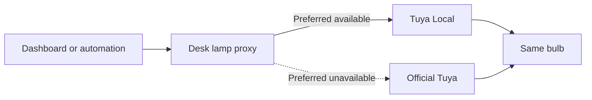

# Entity Proxy

**One Home Assistant control, two ways to reach the same device.**

Use Tuya Local for your desk lamp and give it a cloud fallback through the
official Tuya integration. Your dashboard and automations keep using one
light. When Tuya Local reports the bulb unavailable, Entity Proxy uses the
cloud entity. When local control comes back, the next command goes local.

[Install](#install-from-marketplace) · [See more pairs](#more-pairs)



## Try it with a Tuya light

1. Set up the same bulb in [Tuya Local](https://github.com/make-all/tuya-local)
   and [the official Tuya integration](https://www.home-assistant.io/integrations/tuya/).
2. In Entity Proxy, name the pair **Desk Lamp**. Pick the Tuya Local light as
   **Preferred entity** and its official Tuya counterpart as **Fallback entity**.
3. Use the new proxy in your dashboard or automation. If Home Assistant assigned
   it `light.desk_lamp` and both sources support dimming, an action looks like this.

```yaml
action: light.turn_on
target:
  entity_id: light.desk_lamp
data:
  brightness_pct: 40
```

Look at the proxy's `active_entity_id` state attribute to see which source
it currently follows.

## More pairs

Choose two entities of the same type that control the same physical device.
The two sources can use different integrations. These IDs are examples.

| Device | Preferred entity | Fallback entity | What the proxy can expose |
| --- | --- | --- | --- |
| Desk lamp | `light.desk_lamp_local` | `light.desk_lamp_cloud` | On and off, plus brightness, colour, colour temperature and transitions when shared |
| Workbench plug | `switch.workbench_lan` | `switch.workbench_cloud` | On and off. The two sources could be MQTT and the vendor's cloud integration |
| Office thermostat | `climate.office_lan` | `climate.office_cloud` | Shared HVAC modes, power controls and temperature targets. Ranges of 5–30 °C and 10–25 °C give the proxy a 10–25 °C range |

## Install from Marketplace

Requires **Home Assistant 2026.11.3** or newer.

1. Open **Settings → Marketplace → Add from link**.
2. Enter `meshaabi/ha-entity-proxy` and add it as an integration.
3. Install **Entity Proxy**, give the proxy a name and select the two sources.

Have both sources available during setup so the proxy can read their shared
capabilities. If the sources or their capabilities change, use **Reconfigure**
on the integration entry. [Marketplace instructions](https://www.home-assistant.io/integrations/marketplace/#custom-repositories)

For a manual install, copy `custom_components/entity_proxy` into your Home
Assistant configuration's `custom_components` directory. Restart Home
Assistant and add **Entity Proxy** from **Settings → Devices & services**.

## When a source drops out

If both sources are unavailable, the proxy is unavailable too. Each command
goes to one source and any service error comes back to the caller. A service
call can finish before the physical device responds.

## Development

Tests run with synthetic devices on Home Assistant Core 2026.11.3. Use Python
3.14 in an isolated virtual environment.

```sh
python -m pip install 'homeassistant==2026.11.3'
python -m unittest discover -s tests -v
```
